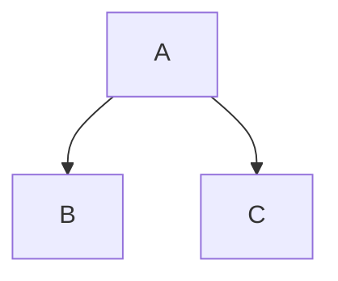

---

title: Mermaid Diagrams
description: A quick guide on how to add Mermaid diagrams on this project
icon: Workflow
permission: dev

---

import example_simple_diagram from '@assets/example-diagrams/example_simple_diagram'
import example_custom_diagram from '@assets/example-diagrams/example_custom_diagram'
import {LuGem} from 'react-icons/lu'


Diagrams is a good way to communicate ideas, list flows and other important things that we can use in this project.

That is then why we are using **Mermaid** to add those into this document, as **Fumadocs** offer's high support to **Mermaid Diagrams** .

### 1. Using **Mermaid** diagrams in **Fumadocs**

Adding diagrams to **Fumadocs** using **Mermaid** can be done in three different ways:

#### Codeblock usage

When using codeblocks, all that is needed is to write the syntax mermaid inside a codeblock, like in the example below:

<Tabs items={['MDX', 'Output']}>
<Tab value="MDX">
````mdx
#### A simple mermaid diagram directly from codeblock

````
</Tab>
<Tab value="Output">
#### A simple mermaid diagram directly from codeblock [!toc]
<Mermaid chart={`
  flowchart TD
    A-->B
    A-->C
`} />
</Tab>
</Tabs>

#### Mermaid component usage

When using the Mermaid component for adding diagrams, this can be done in two different ways:

1. Passing the code for the diagram as a string directly into the **chart** prop of the component:

<Tabs items={['MDX', 'Output']}>
<Tab value="MDX">
```mdx
#### A simple mermaid diagram passing code as prop
<Mermaid
  chart="graph TD;A-->B;A-->C;"
/>
```
</Tab>
<Tab value="Output">
#### A simple mermaid diagram passing code as prop [!toc]
<Mermaid
  chart="graph TD;A-->B;A-->C;"
/>
</Tab>
</Tabs>

2. Importing from a external file (**preferred**):

<Tabs items={['Diagram File', 'MDX', 'Output']}>
<Tab value="Diagram File">
```js title='example_diagram.js'
const example_diagram = `
graph TD;
  A-->B;
  A-->C;
`;

export default example_diagram;
```
</Tab>
<Tab value="MDX">
```mdx
import example_diagram from 'path/to/example_diagram'
#### A simple mermaid diagram importing from external file
<Mermaid chart={example_diagram} />
```
</Tab>
<Tab value="Output">
#### A simple mermaid diagram importing from external file [!toc]
<Mermaid chart={example_simple_diagram} />
</Tab>
</Tabs>

---

### 1. Customizing diagrams

Diagrams can be customized following **Mermaid** syntax while providing the diagram code. Below we have an example of a customized diagram made with **Mermaid**.

A example code regarding customizing diagrams is accessible [here, as a reference](/examples/example_custom_diagram.js).

<Mermaid chart={example_custom_diagram} />


## What is next? [!toc]

<Cards>
  <Card href='https://mermaid.js.org/intro/'>
    Learn **Mermaid's Syntax**
  </Card>
</Cards>


